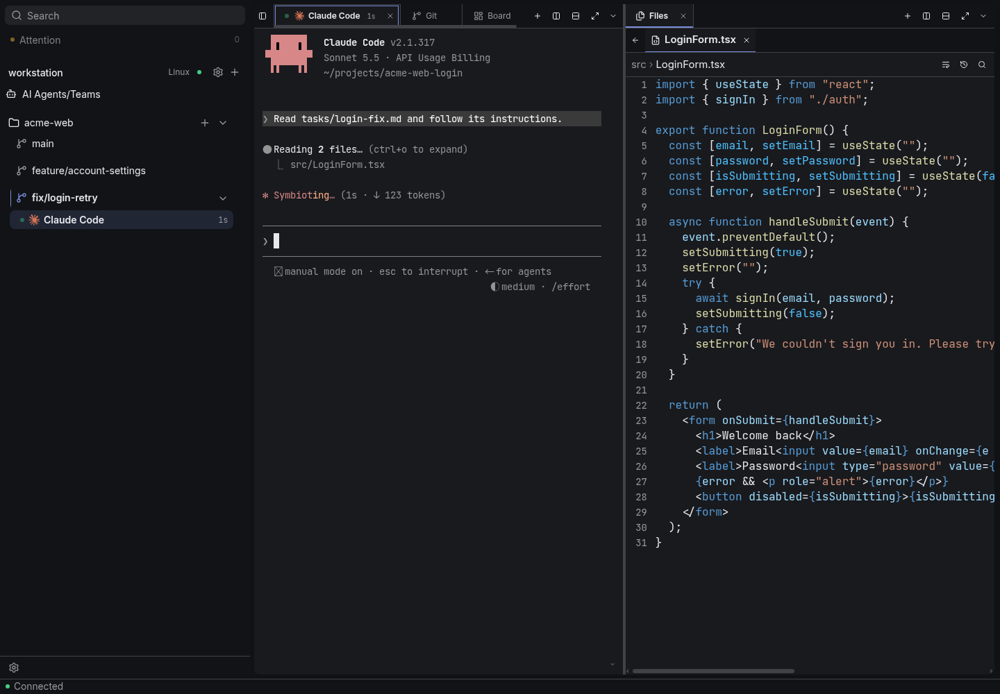
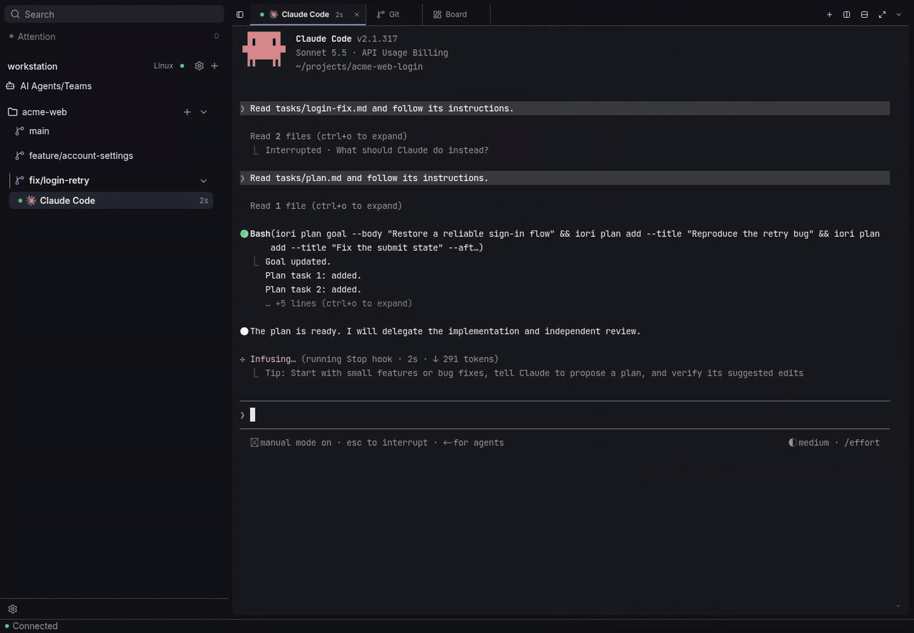
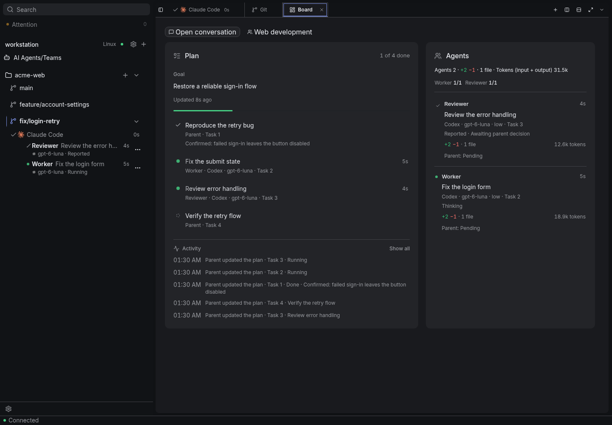
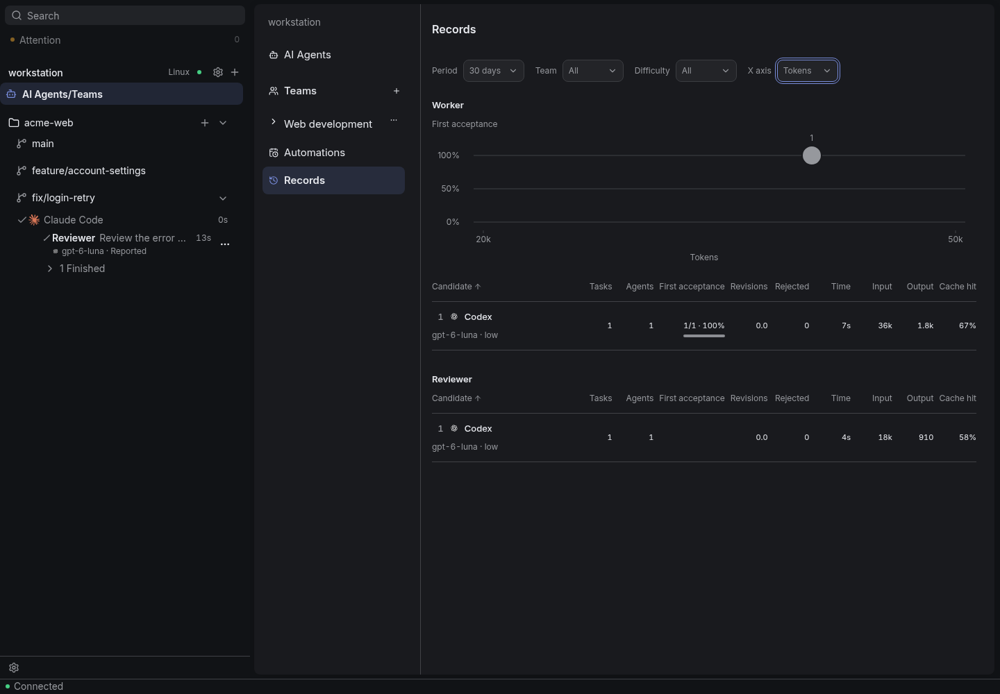
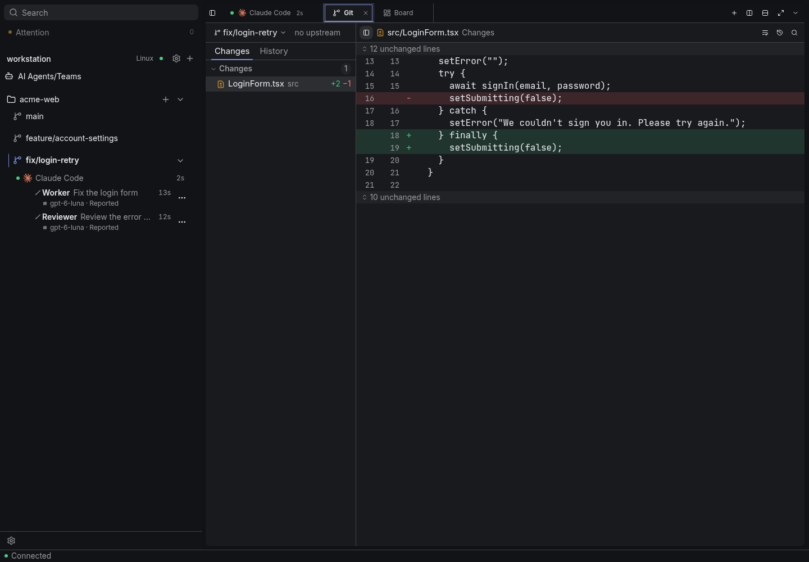
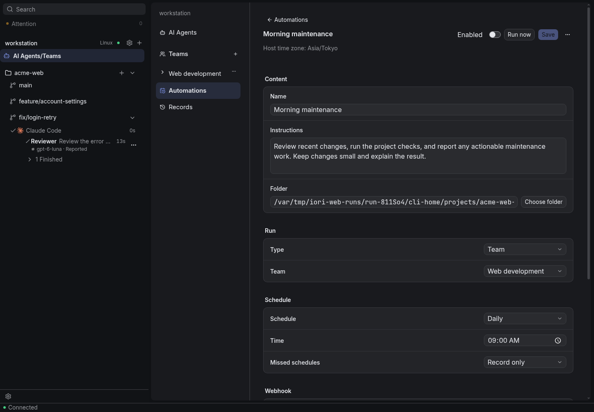
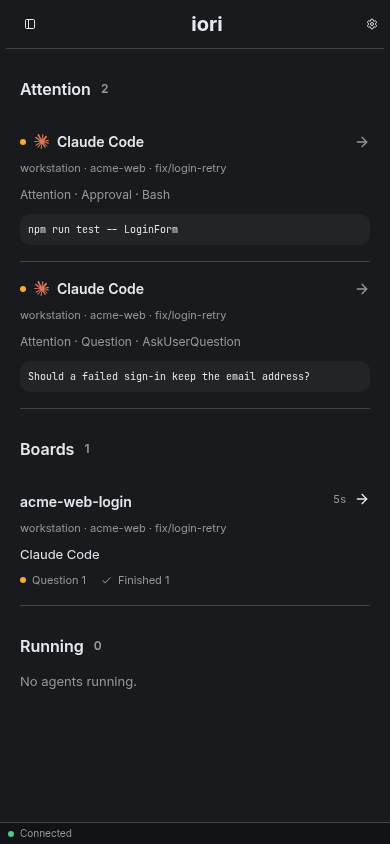
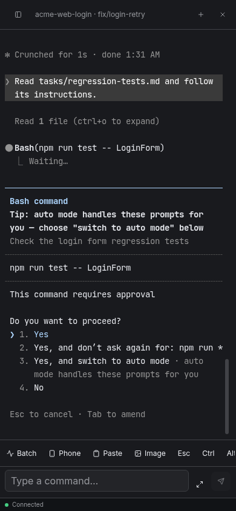

# iori

**自分のマシンで動く CLI の AI エージェントを、PC からもスマートフォンからも、CLI 自身の画面のまま使い続けられるアプリ。**

Claude Code や Codex などの CLI エージェントは、作業するマシンの中で動きます。iori は、手元の端末からそのマシンへ接続して、エージェントとの作業を続けるためのアプリです。iori 独自の画面に置き換えることはせず、CLI 自身の画面をそのまま使います。エージェントが質問や承認で止まったときは、スマートフォンからでも確認して答えられます。

[English](README.md) | [日本語](README.ja.md)

<picture>
  <source media="(prefers-color-scheme: dark)" srcset="docs/images/hero-dark.png">
  <source media="(prefers-color-scheme: light)" srcset="docs/images/hero-light.png">
  
</picture>

iori は2つのプログラムでできています。プロジェクトのあるマシンで動く **iori Host** と、手元の端末から Host につなぐ **iori Client** です。Host と Client は同じ端末に入れることも、別々の端末に入れることもできます。Client を閉じても Host の上のエージェントは動き続けるので、席を外したり別の端末に移ったりしても、作業の続きから再開できます。

- **Client:** Windows・Linux・Android
- **Host:** Windows・Linux

※ スクリーンショットは英語表示のものです。アプリ自体は日本語表示にも切り替えられます。

## できること

### エージェントを CLI 自身の画面で使う

Claude Code・Codex・Pi・OpenCode・Cursor CLI・Antigravity CLI などの CLI を、デスクトップで使うときと同じ、CLI 自身の画面のまま動かせます。画面の横では、プロジェクトのファイル・Markdown・画像と、Git の変更や履歴も確認できます。

### Team に任せる

<picture>
  <source media="(prefers-color-scheme: dark)" srcset="docs/images/team-delegation-dark.gif">
  <source media="(prefers-color-scheme: light)" srcset="docs/images/team-delegation-light.gif">
  
</picture>

大きな仕事は、複数のエージェントからなる **Team** に任せられます。親エージェントがあなたと相談して目標を決め、計画を書き、Worker や Reviewer といった役割の子エージェントへ仕事を委譲します。役割ごとに、担当への指示と、難易度に応じた CLI とモデルの候補を設定できるので、簡単な仕事は安いモデルに回すといった使い分けができます。Team には、開発・調査・執筆のテンプレートがあり、テンプレートをもとに自由に役割やモデルの割り当て、担当への指示を変更できます。

**Board** には、計画、どのエージェントがどのタスクを進めているか、その変更と Tokens が並びます。子エージェントは親エージェントへ報告し、親エージェントは結果を確認して、必要な直しを頼んでから受け入れます。

<picture>
  <source media="(prefers-color-scheme: dark)" srcset="docs/images/team-board-dark.png">
  <source media="(prefers-color-scheme: light)" srcset="docs/images/team-board-light.png">
  
</picture>

**Records** では、役割ごとに、各 CLI とモデルの実績（1回目で受け入れられた割合、差し戻しの回数、時間、Tokens）を比べられます。どの役割にどのモデルを使うかを決める材料になります。

<picture>
  <source media="(prefers-color-scheme: dark)" srcset="docs/images/records-dark.png">
  <source media="(prefers-color-scheme: light)" srcset="docs/images/records-light.png">
  
</picture>

### タスクごとに worktree を分ける

サイドバーから、タスクごとに Git の worktree を作り、そこでエージェントや Team を始められます。worktree ごとにエージェントと変更が分かれて並ぶので、いくつものタスクを並行して進められます。

<picture>
  <source media="(prefers-color-scheme: dark)" srcset="docs/images/worktrees-git-dark.png">
  <source media="(prefers-color-scheme: light)" srcset="docs/images/worktrees-git-light.png">
  
</picture>

### 自動で仕事を始める

**Automations** は、決まった時刻、LAN 内からの Webhook、GitHub・Forgejo・Gitea の Issue に付いたラベルをきっかけに、エージェントや Team を自動で起動します。

<picture>
  <source media="(prefers-color-scheme: dark)" srcset="docs/images/automations-dark.png">
  <source media="(prefers-color-scheme: light)" srcset="docs/images/automations-light.png">
  
</picture>

### スマートフォンから答える

**Attention** には、すべてのエージェントと Host からの質問と承認待ちが1か所に集まります。スマートフォンからエージェントの画面を開いて、画面下のキーバー（ターミナル用の補助キー）で答えられます。

<p>
  <picture>
    <source media="(prefers-color-scheme: dark)" srcset="docs/images/mobile-attention-dark.png">
    <source media="(prefers-color-scheme: light)" srcset="docs/images/mobile-attention-light.png">
    
  </picture>
  <picture>
    <source media="(prefers-color-scheme: dark)" srcset="docs/images/mobile-terminal-dark.png">
    <source media="(prefers-color-scheme: light)" srcset="docs/images/mobile-terminal-light.png">
    
  </picture>
</p>

## iori Client を入れる

- **Windows:** [インストーラー](https://github.com/ioriapp/iori/releases/latest/download/iori-setup-windows-x64.exe)を実行します。まだコード署名をしていないので、Microsoft Defender SmartScreen の警告が出ることがあります。「詳細情報」→「実行」で進めてください。インストールは自分のユーザーに対してだけ行われます。
- **Linux**（Ubuntu 22.04・Debian 12 以降）: [deb](https://github.com/ioriapp/iori/releases/latest/download/iori-linux-x64.deb) を `sudo apt install ./iori-linux-x64.deb` で入れるか、[AppImage](https://github.com/ioriapp/iori/releases/latest/download/iori-linux-x64.AppImage) に実行の権限を付けて開きます。どちらも GNOME Keyring や KWallet などの OS のキーリングが要ります。
- **Android:** [APK](https://github.com/ioriapp/iori/releases/latest/download/iori-android-arm64.apk) を開きます。許可を求められたら、APK を開いたブラウザーやファイルアプリに「この提供元を許可」を有効にしてください。[Obtainium](https://github.com/ImranR98/Obtainium) で Release を追うこともできます。

## iori Host を入れる

Windows・Linux では、iori Client で「iori Hostを用意する」を選び、「この PC」にインストールします。Host のインストールから Client との紐付けまで自動で進みます。別の Linux・Windows マシンへ Host をインストールするには「別のマシン（SSH）」を選びます。`~/.ssh/config` の設定がそのまま使われます。Windows では、SSH で接続するユーザーがその PC の管理者である必要があります。管理者でない時は、その PC で Host をインストールし（「この PC」か下のインストールのコマンド）、ほかの端末からの接続を管理者に許可してもらってから、招待でこの Client を登録してください。

コマンドから入れることもできます。プロジェクトで作業するいつものユーザーで実行してください。管理者の権限は要りません。

```sh
# Linux
curl -fsSL https://github.com/ioriapp/iori/releases/latest/download/install.sh | sh
```

```powershell
# Windows（PowerShell）
irm https://github.com/ioriapp/iori/releases/latest/download/install.ps1 | iex
```

コマンドで入れると、Host が招待を QR コードと文字列で表示します。Client の「招待で接続する」で文字列を貼り付けるか QR コードを読み取り、登録します。後から別の端末を足す時は、Host のマシンで `iori-host invite` を実行します。

Windows の WSL の中で Host を動かす時は、[WSL で iori Host を動かす](guides/wsl.ja.md)を参照してください。

## 接続する

Client は LAN か VPN で Host へ直接接続します。Windows の Host は、Windows のファイアウォールで外からの接続を止められます。スマートフォンや別の PC から接続するには、Host の設定の「接続」で「ほかの端末からの接続を許可する」を押してください（Windows の管理者の確認が出ます）。1つの Client から、複数の Host に同時に接続できます。

直接接続ができない時は、自分で立てた [iroh-relay](https://github.com/n0-computer/iroh) の URL を Host の設定の「接続」に入れると、Client はまず直接接続を試行し、届かない時だけ Relay を通します。

## 更新する

新しいバージョンがあると、Client の設定の入口に印が付きます。Client は設定の「この PC」→「一般」から更新します。Host は Client の設定で Host の「バージョン」から更新し、Client と同じバージョンになります。

更新は安定版だけが対象です。開発中のバージョン（pre-release）も受け取るには、同じ画面の「開発バージョンを受け取る」を ON にします。

## ほかの CLI を追加する

Claude Code・Codex・Pi・OpenCode・Cursor CLI・Antigravity CLI は、iori で実際に使って動作を確認しています。ほかのいくつかの CLI の定義も同梱しています。それ以外の CLI も、「AI Agents」の「CLIを追加」から追加できます。定義の書き方は [CLI 定義追加手順](guides/cli-definitions.ja.md) を参照してください。

**他の人が作った定義は、中身を読んでから追加してください。** 定義は Host の上であなたのユーザーの権限でコマンドやスクリプトを動かし、CLI の設定に hooks を書きます。

## ソースから build する

Node.js 24、pnpm 11、[rust-toolchain.toml](rust-toolchain.toml) の Rust と、OS ごとの [Tauri の準備](https://v2.tauri.app/start/prerequisites/)が要ります。

```sh
pnpm install --frozen-lockfile
pnpm --filter @iori/host build:native
pnpm --filter @iori/host dev     # Host を起動する
pnpm --filter @iori/host invite  # 別の Terminal で: 招待を作る
pnpm tauri dev                   # Client を起動する
```

開発の詳しい手順は [DEVELOPMENT.md](DEVELOPMENT.md) にあります。

## このプロジェクトについて

iori は個人が空いた時間に開発しています。対応や返答は約束できません。不具合や要望は [GitHub の Issue](https://github.com/ioriapp/iori/issues) へお寄せください。Pull request は今は受け付けていません。脆弱性の報告は [SECURITY.md](SECURITY.md) を参照してください。

iori は [MIT ライセンス](LICENSE)で公開しています。
