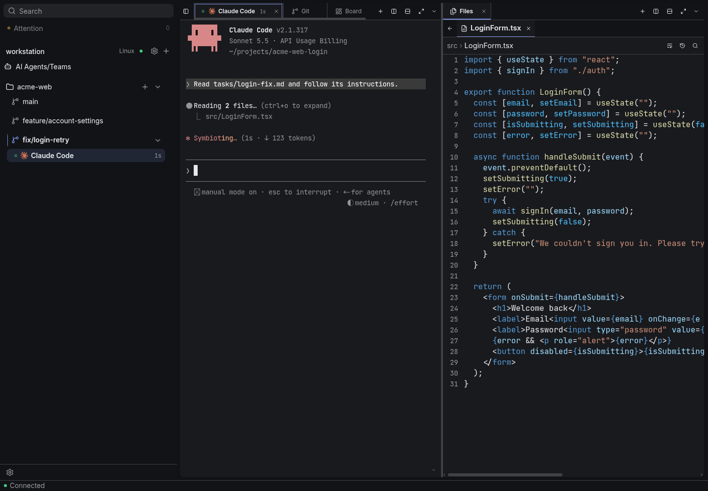
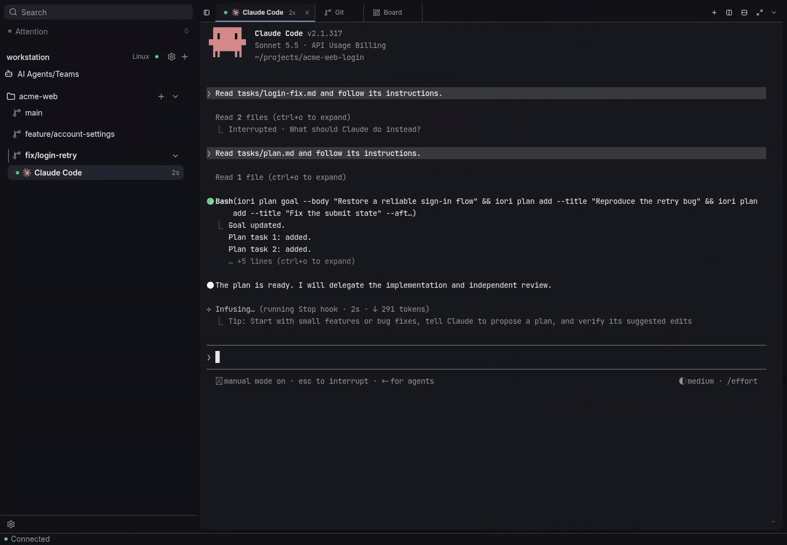
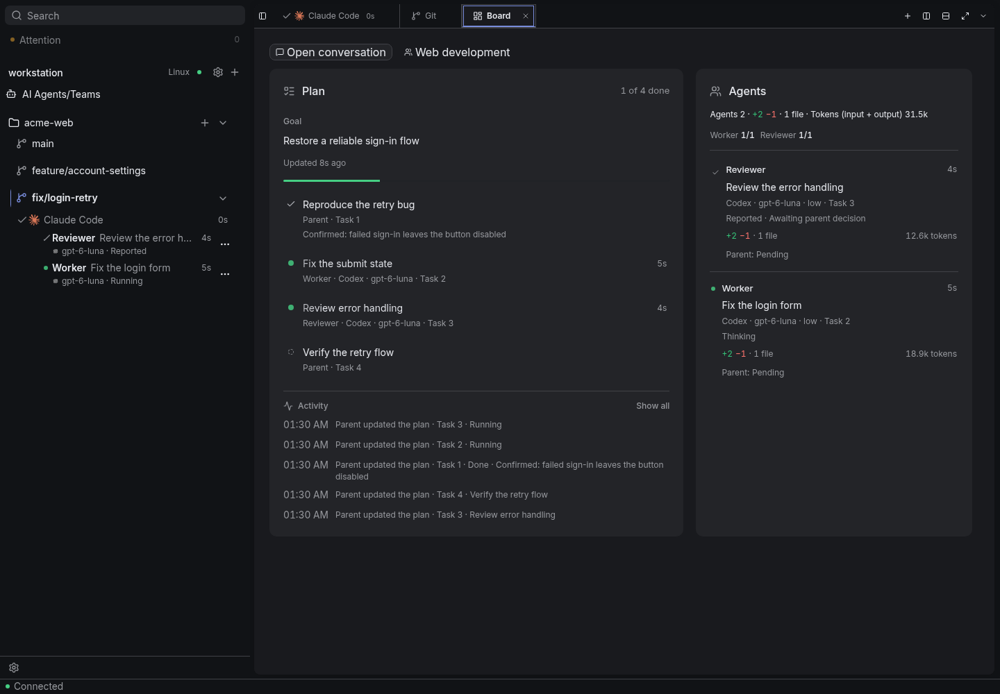
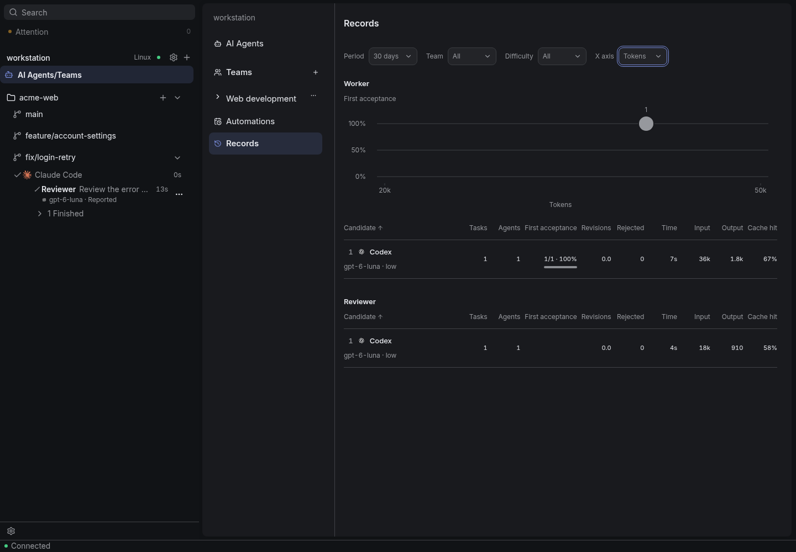
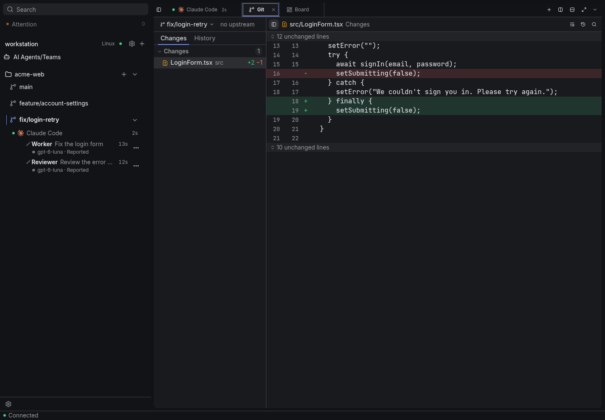
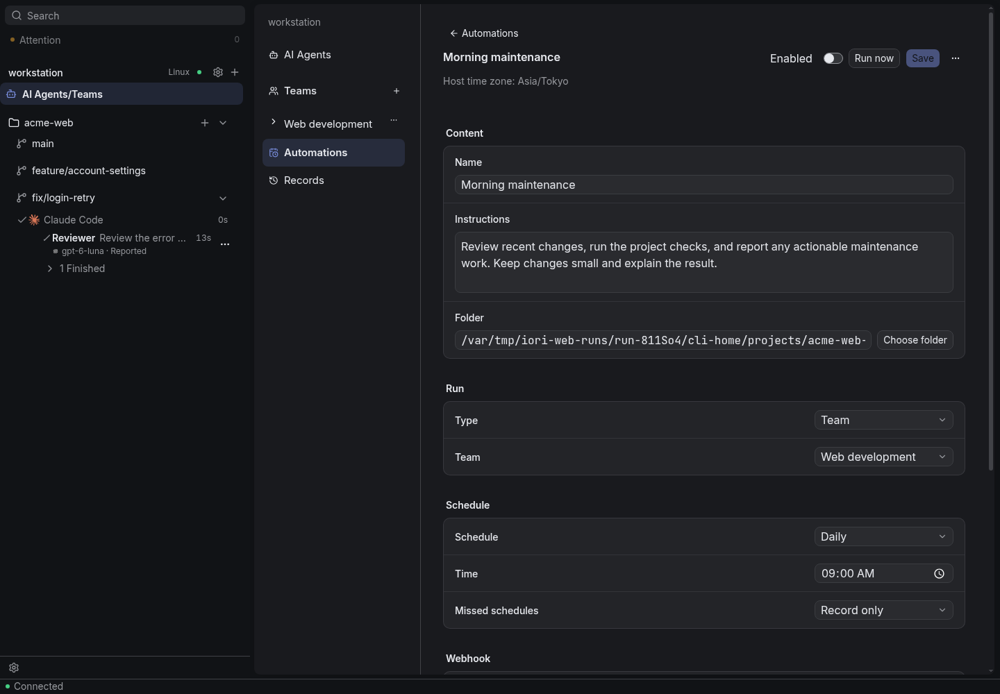
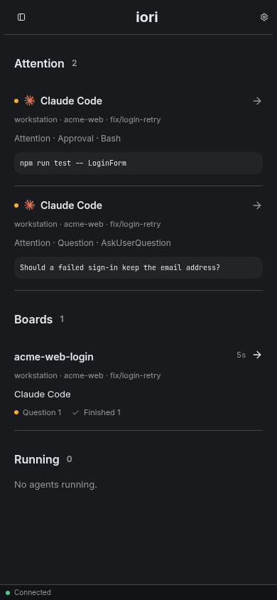
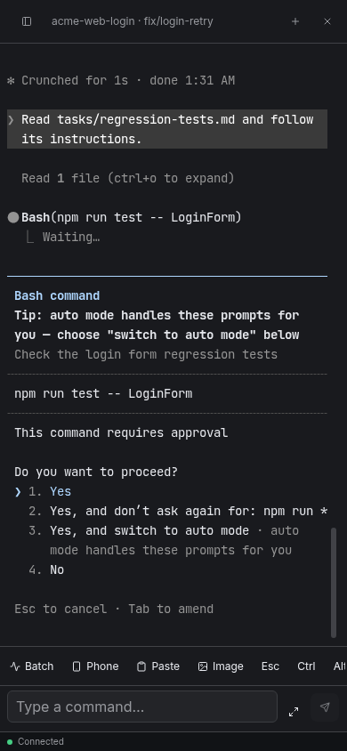

# iori

**Keep using CLI AI agents running on your own machine, in their own terminal, from your PC or phone.**

CLI agents such as Claude Code and Codex run on the machine where you work. iori connects your device to that machine so you can keep working with your agents. You use the CLI’s own terminal throughout. When an agent pauses for a question or approval, you can review it and respond from your phone.

[English](README.md) | [日本語](README.ja.md)

<picture>
  <source media="(prefers-color-scheme: dark)" srcset="docs/images/hero-dark.png">
  <source media="(prefers-color-scheme: light)" srcset="docs/images/hero-light.png">
  
</picture>

iori consists of two programs. **iori Host** runs on the machine that has your projects, and **iori Client** connects your device to the Host. You can install the Host and Client on the same machine or on separate devices. Agents keep running on the Host when you close the Client, so you can step away or switch devices and pick up where you left off.

- **Client:** Windows, Linux and Android
- **Host:** Windows and Linux

The screenshots show the English interface. You can also switch the app to Japanese.

## What you can do

### Use agents in their own terminal

Claude Code, Codex, Pi, OpenCode, Cursor CLI, Antigravity CLI and other CLIs run in their own terminal, just as they do on your desktop. Alongside it, you can view the project’s files, Markdown and images, as well as Git changes and history.

### Delegate to a team

<picture>
  <source media="(prefers-color-scheme: dark)" srcset="docs/images/team-delegation-dark.gif">
  <source media="(prefers-color-scheme: light)" srcset="docs/images/team-delegation-light.gif">
  
</picture>

For larger jobs, you can delegate to a **Team** of agents. A parent agent discusses the goal with you, writes a plan, and delegates work to child agents in roles such as Worker and Reviewer. For each role, you can set instructions and CLI and model candidates by difficulty, so simple tasks can go to a cheaper model. Teams come with templates for development, research and writing. Use a template as a starting point and customize its roles, model assignments and instructions.

The **Board** shows the plan, which agent is working on which task, their changes and Tokens. Child agents report back to the parent agent, which checks the results and asks for any necessary fixes before accepting them.

<picture>
  <source media="(prefers-color-scheme: dark)" srcset="docs/images/team-board-dark.png">
  <source media="(prefers-color-scheme: light)" srcset="docs/images/team-board-light.png">
  
</picture>

**Records** compares how each CLI and model did in each role: how often their work was accepted the first time, revisions, time and Tokens. Use it to decide which models to give each role.

<picture>
  <source media="(prefers-color-scheme: dark)" srcset="docs/images/records-dark.png">
  <source media="(prefers-color-scheme: light)" srcset="docs/images/records-light.png">
  
</picture>

### Keep each task in its own worktree

Create a Git worktree for each task from the sidebar and start an agent or a team in it. Agents and changes are grouped by worktree, so you can work on several tasks in parallel.

<picture>
  <source media="(prefers-color-scheme: dark)" srcset="docs/images/worktrees-git-dark.png">
  <source media="(prefers-color-scheme: light)" srcset="docs/images/worktrees-git-light.png">
  
</picture>

### Start work automatically

**Automations** start an agent or a team at a set time, when a webhook arrives from your LAN, or when a label is added to an Issue on GitHub, Forgejo or Gitea.

<picture>
  <source media="(prefers-color-scheme: dark)" srcset="docs/images/automations-dark.png">
  <source media="(prefers-color-scheme: light)" srcset="docs/images/automations-light.png">
  
</picture>

### Answer from your phone

**Attention** collects the questions and approvals from all your agents and Hosts in one place. On your phone, you can open an agent's terminal and answer using the key bar at the bottom of the screen, which provides extra terminal keys.

<p>
  <picture>
    <source media="(prefers-color-scheme: dark)" srcset="docs/images/mobile-attention-dark.png">
    <source media="(prefers-color-scheme: light)" srcset="docs/images/mobile-attention-light.png">
    
  </picture>
  <picture>
    <source media="(prefers-color-scheme: dark)" srcset="docs/images/mobile-terminal-dark.png">
    <source media="(prefers-color-scheme: light)" srcset="docs/images/mobile-terminal-light.png">
    
  </picture>
</p>

## Install iori Client

- **Windows:** Run the [installer](https://github.com/ioriapp/iori/releases/latest/download/iori-setup-windows-x64.exe). The installer is not code-signed yet, so Microsoft Defender SmartScreen may show a warning. Select **More info**, then **Run anyway**. iori is installed for your user only.
- **Linux** (Ubuntu 22.04, Debian 12 or later): Install the [deb package](https://github.com/ioriapp/iori/releases/latest/download/iori-linux-x64.deb) with `sudo apt install ./iori-linux-x64.deb`, or make the [AppImage](https://github.com/ioriapp/iori/releases/latest/download/iori-linux-x64.AppImage) executable and run it. Both need an OS keyring such as GNOME Keyring or KWallet.
- **Android:** Open the [APK](https://github.com/ioriapp/iori/releases/latest/download/iori-android-arm64.apk). If Android asks, allow installing apps from the browser or file manager you used. You can also follow the releases with [Obtainium](https://github.com/ImranR98/Obtainium).

## Install iori Host

On Windows or Linux, open iori Client, choose **Set up iori Host**, and install it on **This PC**. Installation and registration with the Client happen automatically. To install the Host on another Linux or Windows machine, choose **Another machine (SSH)**. The Client uses your OpenSSH settings in `~/.ssh/config`. On Windows, the SSH user must be an administrator of that PC. If you are not an administrator there, install the Host on that PC itself (**This PC**, or the install command below), have an administrator allow connections from other devices, and register this Client with an invitation.

You can also install the Host from a terminal, as the user who works on the projects. No administrator rights are needed.

```sh
# Linux
curl -fsSL https://github.com/ioriapp/iori/releases/latest/download/install.sh | sh
```

```powershell
# Windows (PowerShell)
irm https://github.com/ioriapp/iori/releases/latest/download/install.ps1 | iex
```

When installed from a terminal, the Host shows an invitation as a QR code and text. In the Client, choose **Connect with an invitation**, paste the text or scan the QR code, and register. To add another device later, run `iori-host invite` on the Host.

## Connect

Clients connect to the Host directly over your LAN or a VPN. Windows Firewall blocks incoming connections to a Windows Host. To connect from your phone or another PC, select **Allow connections from other devices** in the Host's **Connection** settings (Windows asks for administrator approval). One Client can use several Hosts at the same time.

If the Host cannot be reached directly, you can run your own [iroh-relay](https://github.com/n0-computer/iroh) server and enter its URL in the Host's **Connection** settings. The Client tries a direct connection first and uses the relay only when needed.

## Update

The Client checks for updates and shows a badge on Settings when a new version is available. Update it from **Settings → This PC → General**. You can update the Host from its **Version** settings in the Client. The Host is updated to the same version as the Client.

Updates use stable releases. To also receive development versions (pre-releases), turn on **Receive development versions** in the same settings.

## Add other CLIs

Claude Code, Codex, Pi, OpenCode, Cursor CLI and Antigravity CLI are tested with iori. Definitions for several other CLIs are included. You can add any other CLI from **Add CLI** in **AI Agents**. See [Adding CLI definitions](guides/cli-definitions.md) for how to write a definition.

**Read a definition before you add one made by someone else.** A definition runs commands and scripts on the Host as your user, and can write hooks to the CLI's settings.

## Build from source

You need Node.js 24, pnpm 11, the Rust toolchain in [rust-toolchain.toml](rust-toolchain.toml), and the [Tauri prerequisites](https://v2.tauri.app/start/prerequisites/) for your OS.

```sh
pnpm install --frozen-lockfile
pnpm --filter @iori/host build:native
pnpm --filter @iori/host dev     # start the Host
pnpm --filter @iori/host invite  # in another terminal: create an invitation
pnpm tauri dev                   # start the Client
```

More details for development are in [DEVELOPMENT.md](DEVELOPMENT.md) (in Japanese).

## About this project

iori is developed by one person in their spare time. Support and responses are not guaranteed. Please report bugs and requests in [GitHub Issues](https://github.com/ioriapp/iori/issues). Pull requests are not accepted for now. To report a vulnerability, see [SECURITY.md](SECURITY.md).

iori is released under the [MIT License](LICENSE).
